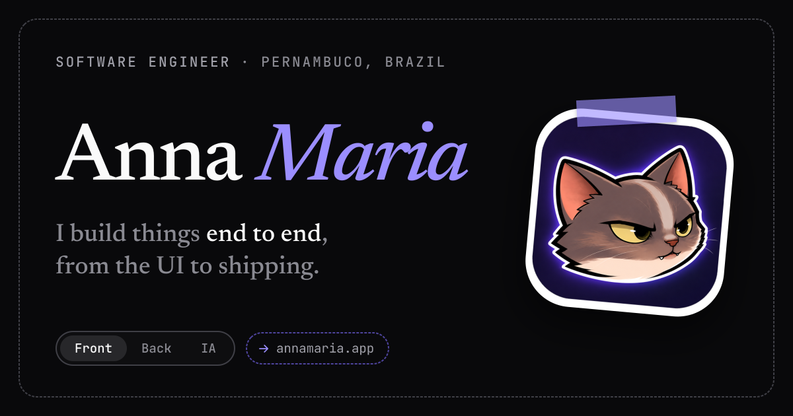

<p align="center">
  
</p>

<p align="center">
  <a href="https://annamaria.app">Live</a> ·
  <a href="https://annamaria.app/notes">Notes</a> ·
  <a href="https://annamaria.app/projects">Projects</a> ·
  <a href="https://entrepta.vercel.app">entrepta</a>
</p>

<p align="center">
  <a href="https://github.com/imnotannamaria/anna.maria.dev/actions/workflows/test.yml"></a>
  
  
  
</p>

# anna.maria.dev

A personal site with three sides. The **Front** is the pages, the **Back** is a terminal over the same content, and the **IA** is a chat that answers about me. A cat lives in the corner and has opinions about what you click.

It comes in English and Portuguese, and it is also an open source template for full-stack engineers: fork it, swap in your own name, content and keys, and deploy.

## What's inside

| Page            | What it is                                                                                             |
| --------------- | ------------------------------------------------------------------------------------------------------ |
| `/`             | Home: a door to each page                                                                              |
| `/person`       | Who I am when I'm not working: photos, a playlist, Apple Watch rings, the weather, stickers, a shelf   |
| `/professional` | Where I work, where I've worked and what I work with: career, stack, apps, GitHub contributions        |
| `/notes`        | MDX posts, with Shiki highlighting                                                                     |
| `/projects`     | Projects as folders in a browser window, each with a case study in MDX                                 |
| `/wall-of-love` | Letters from people I worked with, as messages in a channel, with reactions. Written through an invite |
| `/contact`      | A postcard sent through Resend and React Email, with a honeypot                                        |
| `/log`          | One feed for everything I finish: films, series, books, albums, podcasts, games, with ratings          |
| `/back`         | A terminal: `ls`, `cd`, `cat`, `open`, over the site's own content                                     |
| `/ai`           | A chat that answers about me and the site, with a model behind layers of limits                        |
| `/admin`        | CRUD for the log and the wall, and the memory board, behind WorkOS AuthKit and an email allowlist      |

Every page of the front ends in the same footer: a memory game whose pairs are the pages, with a board of the ten fastest rounds, and the license line as a diff. Every page exists at `/pt/...` too. Light and dark, dynamic OG images, a sitemap, `hreflang` and canonical URLs come with it. Spotify, the Apple Watch card, the log, the wall and the chat are all optional: without their keys the site still builds, and each one says so in its place.

[Abimaela](docs/abimaela.md), the cat, is a set of sprite sheets and a table of what she reacts to.

## Stack

Next.js 16 (App Router), React 19, TypeScript strict, Tailwind v4 and [entrepta](https://entrepta.vercel.app) for the design system. next-intl for the two languages, MDX through Velite and Shiki, Motion for animation, Postgres through Drizzle, a Hono API at `/api/v1`, WorkOS AuthKit for the admin, Resend for email, OpenRouter for the chat. Deployed on Vercel.

## Built on entrepta

The UI runs on [entrepta](https://github.com/imnotannamaria/entrepta), a dark-first design system. entrepta started inside this site, and v2 was built here first.

It is not a runtime dependency. Its CLI copies source into the repo, and three places belong to it rather than to the site:

- `app/components/entrepta/`, the components
- `app/entrepta.css`, the tokens, the six themes, the reset and the loading classes
- `lib/utils.ts`, `lib/motion.ts`, `lib/icon.tsx`, `lib/overlay.ts` and the hooks in `hooks/`

What the site adds on top lives elsewhere: its pieces and their CSS in `components/site/`, its helpers in `lib/format.ts`, and `components/site/frame/`, which binds entrepta's Sidebar and MobileNav to the site's routes.

To update a component, run `npx @entrepta/cli@latest add <name> --overwrite` and read the diff. To update the tokens, bump `@entrepta/registry` in `devDependencies` and run `npx vitest run lib/entrepta-sync.test.ts`, which lists what changed.

**Don't run `entrepta init --overwrite` here.** It rewrites `app/globals.css`, which holds the site's own CSS, and adds a Google Fonts import that fights `next/font`.

## Fork it

### 1. Install

```bash
git clone https://github.com/imnotannamaria/anna.maria.dev.git my-site
cd my-site
npm install
```

### 2. Environment

```bash
cp .env.example .env.local
```

Only two variables are required:

```bash
RESEND_API_KEY=re_xxxxxxxxxxxx          # resend.com
NEXT_PUBLIC_BASE_URL=https://yourdomain.com
```

Everything else in `.env.example` is optional and switches on one feature: Spotify, Postgres for the log, the wall and the Apple Watch card, WorkOS for the admin, Vercel Blob for the photos on the wall, a GitHub token for the contributions grid, OpenRouter for the chat.

### 3. Make it yours

| File                                     | What to change                                         |
| ---------------------------------------- | ------------------------------------------------------ |
| `lib/site-config.ts`                     | Name, email, social handles                            |
| `messages/en.json`, `messages/pt.json`   | Every sentence on the site, in both languages          |
| `components/site/professional/career.ts` | Where you worked, and `stack-data.ts`, `app-list.ts`   |
| `components/site/person/`                | Your photos, stickers, objects and the weather's place |
| `components/site/abimaela/`              | The cat: her sheets, and her lines in the messages     |
| `lib/ai/prompt.ts`, `lib/ai/context.ts`  | What the chat knows and how it answers                 |
| `content/`                               | Your posts and projects                                |
| `app/api/contact/route.ts`               | The `from` and `to` of contact emails                  |
| `lib/metadata.ts`                        | The `baseUrl` fallback                                 |
| `public/images/`                         | The avatar and the share image                         |
| `public/sounds/`                         | Generate your own: see Sound effects below             |

### 4. Run

```bash
npm run dev:local
```

`npm run dev` is the same thing wrapped in [Infisical](https://infisical.com), which is how the live site keeps its secrets out of the working tree. On a fork, `dev:local` reads your `.env.local` instead.

Open [localhost:3000](http://localhost:3000).

## Writing content

A post is `content/blog/<slug>.mdx`:

```mdx
---
title: "Your post title"
description: "A short description for SEO and cards."
date: "2026-01-01"
tags: ["next.js", "typescript"]
published: true
---

Your content here.
```

A project is `content/projects/<slug>.mdx`:

```mdx
---
title: "Project name"
description: "What it does in one sentence."
date: "2026-01-01"
tags: ["react", "typescript"]
github: "https://github.com/you/project"
live: "https://project.vercel.app"
cover: "/projects/project.png"
featured: true
published: true
---

## Overview

...
```

`cover` is optional and points at a file in `public/projects/`; without one, the card draws a cover from the slug. The most recent `featured: true` project shows on the home page.

The Portuguese of a post or a project is a file with the same name under `pt/` (`content/blog/pt/<slug>.mdx`), with the same date. Only its title, description and body are read. A test fails when one is missing.

## Optional features

### Spotify playlist

Create an app in the [Spotify Developer Dashboard](https://developer.spotify.com/dashboard), then set `SPOTIFY_CLIENT_ID`, `SPOTIFY_CLIENT_SECRET` and the ID of a public playlist in `SPOTIFY_PLAYLIST_ID`. It uses the Client Credentials flow, server to server, so the secret never reaches the browser.

### The log, the wall of love and the memory board

All three read the same Postgres database.

1. Set `DATABASE_URL` (on Supabase, the transaction pooler string on port 6543) and run the files in [docs/sql/](docs/sql/) against it, in order. `008-drop-roadmap.sql` removes a table of the old site and deletes what is in it: skip it on a new database.
2. Seed sample entries for the log if you like: `npm run seed:log`.
3. For the admin, create an application at [workos.com](https://workos.com), register `<your-domain>/api/auth/callback` as a redirect URI, and fill in the four `WORKOS_*` variables.
4. Put your email in `ADMIN_EMAILS`.

The last step matters. AuthKit decides who is signed in, not who is allowed in; without the allowlist, anyone who signs up in your WorkOS organisation reaches the admin. `lib/auth/require-admin.ts` is the real guard.

A log entry is written in English, with an optional Portuguese title and note beside it. A letter on the wall comes in through an invite: a link you create in the admin, good for three days and one letter, which you approve before it shows. Photos go to Vercel Blob when `BLOB_READ_WRITE_TOKEN` is set. A name on the memory board works the same way: the server times the round, a time in the ten best gets a form, and the name waits for you in `/admin/memory`, with an email when Resend is set. Without the database the game still plays, with no board.

### The chat

Set `OPENROUTER_API_KEY` and `OPENROUTER_MODEL`. Without them the chat answers from a script. With them, a question is screened before it reaches the model, the answer is screened before it reaches the visitor, and there are limits per visitor and per day in Postgres ([docs/sql/005-ai-usage.sql](docs/sql/005-ai-usage.sql)). **Put a credit limit on the key itself**, in the OpenRouter dashboard: it is the cap that holds even if the code is wrong.

### Apple Watch rings

The activity card reads from the same database, fed by an iOS Shortcut. [wristkit](https://wristkit-web.vercel.app/) has the full setup: the migration ([docs/sql/002-wristkit-samples.sql](docs/sql/002-wristkit-samples.sql)), the Shortcut, and the sync endpoint at `/api/v1/wristkit/sync`.

### Sound effects

Sound is a supplement, never the only confirmation. The speaker button in the header silences all of it, and the choice is remembered. Nothing plays before the visitor has interacted with the page, which is also what browsers require.

| Sound              | When                                                                                                                                                                           |
| ------------------ | ------------------------------------------------------------------------------------------------------------------------------------------------------------------------------ |
| `click`            | Any button, tab, menu item, switch or checkbox. A link joins in with `data-sound="click"` (the sidebar and the phone's bar do); `data-sound="off"` opts a part of the page out |
| `success`, `error` | A form was sent or failed, and admin actions                                                                                                                                   |

The files in `public/sounds/` are generated once with the [ElevenLabs Sound Effects API](https://elevenlabs.io/docs/api-reference/text-to-sound-effects/convert) and committed, so visitors never talk to ElevenLabs. The prompt, the moment and the volume of each live in `lib/sound-effects.ts`, and `public/sounds/manifest.json` records where each file came from (prompt, model, date, plan).

**The three files are not under this repository's MIT license**, and a fork should make its own: they were generated on a free plan, which means non-commercial use and a credit to ElevenLabs (elevenlabs.io). See [public/sounds/NOTICE.md](public/sounds/NOTICE.md) and [docs/sound-rights.md](docs/sound-rights.md). To replace them with yours, set `ELEVENLABS_API_KEY` and `ELEVENLABS_PLAN` (`free` or `paid`, it goes into the manifest) and run `npm run generate:sounds -- --force`; without `--force` a sound that exists is skipped, and a name regenerates just that one (`npm run generate:sounds -- click --force`).

A test fails if a file in `public/sounds/` is not in the palette, has no entry in the manifest or does not say its plan, and another if something that takes a click is neither a button, a link nor marked silent on purpose.

## Testing

```bash
npm run test:all
```

One command runs every layer: the unit tests, the integration tests against a real Postgres, and the end-to-end tests in a real browser. It starts a throwaway database in Docker, builds what each layer needs and tears it all down afterwards. Docker or OrbStack has to be running; nothing else needs setting up.

```bash
npm run test:all -- --keep     # leave the database up for a faster rerun
npm run test:all -- --no-e2e   # skip the browser layer and its production build
npm test                       # unit tests only, no infrastructure
```

The integration and e2e suites write to and truncate their database, so both refuse to run unless `DATABASE_URL` points at localhost. The e2e layer needs a browser once: `npx playwright install --with-deps chromium`. What each test guards against, and why nothing mocks Postgres, is in [docs/tests-plan.md](docs/tests-plan.md).

## Deploy

Import the repo at [vercel.com/new](https://vercel.com/new), add the environment variables, and deploy. The sitemap and robots.txt are generated at build time.

## Project structure

```
app/
  [locale]/(site)/         every public page, once per language
  admin/                   log, wall and memory board, behind AuthKit + the allowlist
  components/entrepta/     entrepta components, written by its CLI
  api/                     contact, OG images, the playlist, auth callback, the Hono app at v1/
  entrepta.css             entrepta's tokens and themes
  globals.css              the little CSS the whole site shares
  root-shell.tsx           <html>, fonts, the toaster, the click sound

components/
  site/                    the site: one folder per page, the frame, the cat, the shared pieces
  admin/ wall/ wristkit/   the admin's forms and tables, the invite form, the activity card
  about/ blog/ log/ ui/    the contributions calendar, the MDX renderer, the stars, sound and tooltip

content/                   blog/ and projects/ in MDX, each with a pt/ twin
messages/                  every sentence of the UI, in English and Portuguese
emails/                    the React Email templates
lib/                       API, auth, database, the chat, languages, queries, site config, helpers
docs/                      the cat, the sounds' rights, the SQL migrations, and the old plans
```

## License

MIT for the code. The three sound files in `public/sounds/` are not covered by it: they are ElevenLabs output with terms of their own, in [public/sounds/NOTICE.md](public/sounds/NOTICE.md). Built by [Anna Maria](https://annamaria.app).
